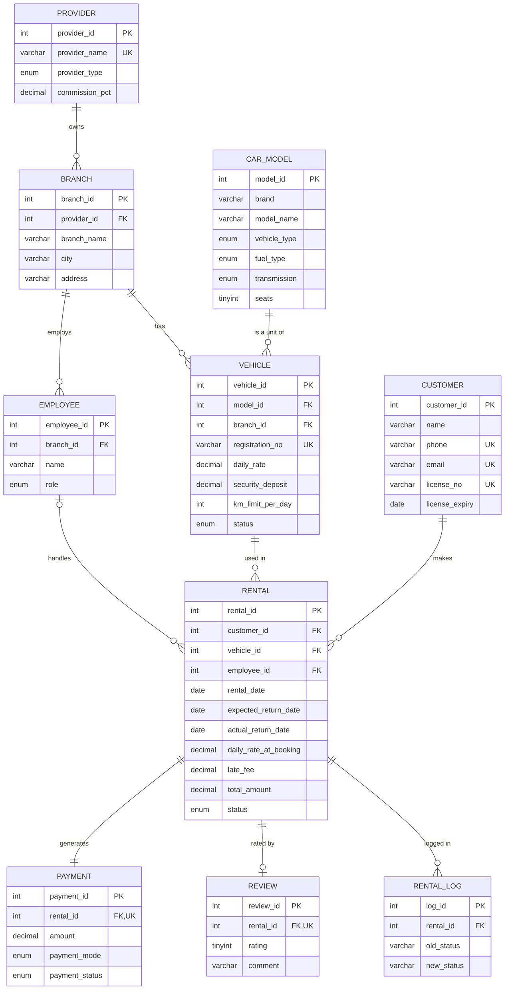

# WheelDeal — Vehicle Rental Management System with Price Comparison

DBMS mini project · Group 17 · Div D · Batch B · SPIT, Mumbai
Tanmay Vidyasagar Upadrasta (2025300262) · Jatin Kamlesh Talesra (2025300253)

A Zomato-style marketplace for rental cars: many providers (agencies and independent owners) list the **same car at different prices**, and the customer compares all offers side by side before booking. All business rules — billing, double-booking prevention, late fees, status changes — are enforced **inside MySQL** with constraints, triggers, functions, stored procedures and transactions.

```
wheeldeal/
├── database/
│   ├── 01_schema.sql          tables, keys, constraints, indexes
│   ├── 02_views.sql           7 views (price comparison, reports)
│   ├── 03_routines.sql        3 functions, 5 triggers, 6 procedures
│   ├── 04_seed_data.sql       6 providers, 11 branches, 116 vehicles, 34 rentals
│   ├── 05_demo_queries.sql    16 labelled queries for the viva
│   └── 06_query_log.sql       watch the website's SQL live in Workbench
├── public/                    website: index.html, styles.css, app.js
├── server.js                  Express REST API (also the Vercel function)
├── db.js                      MySQL connection pool (mysql2)
├── package.json
└── .env.example               settings template (copy to .env)
```

## How to run

**Requirements:** MySQL 8.0+ and Node.js 20+.

1. **Create the database** — run the files in order (MySQL Workbench: open each file → ⚡ Execute; or terminal):
   ```bash
   cd database
   mysql -u root -p < 01_schema.sql
   mysql -u root -p < 02_views.sql
   mysql -u root -p < 03_routines.sql
   mysql -u root -p < 04_seed_data.sql
   ```
   To reset the demo at any time, run all four again (file 1 drops and recreates the database).
   Sample rental dates are relative to `CURDATE()`, so the demo always has past, ongoing and upcoming rentals.

2. **Start the app** (from the project folder)
   ```bash
   cp .env.example .env        # Windows: copy .env.example .env
   # edit .env and set DB_PASSWORD to your MySQL root password
   npm install
   npm start
   ```

3. Open **http://localhost:3000**.

> If `CREATE FUNCTION` fails with error 1418 ("binary logging is enabled"), run
> `SET GLOBAL log_bin_trust_function_creators = 1;` once as root, then re-run `03_routines.sql`.

## Deploying online (GitHub + Vercel)

Vercel runs the website and the API, but it cannot host MySQL. The database lives on a free cloud MySQL server, and Vercel connects to it.

1. **Cloud MySQL** – create a free MySQL service on [Aiven](https://aiven.io) (or [Railway](https://railway.com)). Note its host, port, user, password, and download the CA certificate.
2. **Load the database** – in MySQL Workbench, add a connection to the cloud server (SSL: *Require*), then run `01_schema.sql` → `02_views.sql` → `03_routines.sql` → `04_seed_data.sql` → `06_query_log.sql`.
3. **Push to GitHub** – push this folder (`.env` and `node_modules` are ignored by `.gitignore`).
4. **Import into Vercel** – vercel.com → Add New → Project → pick the repo. Framework preset: *Express* (auto-detected). Leave build settings empty.
5. **Environment variables** (Project → Settings → Environment Variables):

   | Name | Value |
   |---|---|
   | DB_HOST | cloud host, e.g. `mysql-xxxx.aivencloud.com` |
   | DB_PORT | cloud port, e.g. `12345` |
   | DB_USER | e.g. `avnadmin` |
   | DB_PASSWORD | cloud password |
   | DB_NAME | `vehicle_rental_db` |
   | DB_SSL | `true` |
   | DB_CA_CERT | (optional) full text of the CA certificate |

6. **Deploy.** Every `git push` to `main` redeploys automatically; pushes to other branches get preview URLs.

If the website ever shows old sample dates (rentals all in the past), re-run `04_seed_data.sql` after `01`–`03` on the cloud database to refresh them.

## Watching the website's SQL in MySQL Workbench

Every statement the website runs is saved by the backend in the table **`api_query_log`**: the time, the screen (endpoint), the full SQL with real values, the rows returned, how long it took, and any error the database raised.

1. Open `database/06_query_log.sql` in Workbench. If you set up the database before this file existed, run PART A once to create the table. A fresh run of `01_schema.sql` already includes it.
2. Use the website: search, open a car, book, cancel, return…
3. Back in Workbench, put the cursor on a query and press **Ctrl+Enter**:
   - **B1** shows the latest 30 statements.
   - **B3** shows only stored-procedure calls.
   - **B4** shows what the database rejected, with the trigger's message (e.g. a double booking).
   - **B5** shows statement counts and speed per screen.
4. Copy any `sql_text` and run it in Workbench to get the same result the website showed.

Run `TRUNCATE TABLE api_query_log;` to clear the log before a demo. Set `LOG_QUERIES=false` in `.env` (or on Vercel) to switch logging off.

## Completing the ER diagram

The original ER diagram had 6 entities and stored brand/model inside VEHICLE. That makes price comparison impossible: there is no way to know that two vehicles from two providers are "the same car". The design was extended as follows:

| Change | Why |
|---|---|
| **PROVIDER** (new) | The rental company or independent owner — the "restaurant". BRANCH now belongs to a provider. |
| **CAR_MODEL** (new) | Shared catalogue (brand, model, type, fuel, transmission, seats) — the "dish" on many menus. Removes the transitive dependency *vehicle → model → brand/type* (3NF). |
| **VEHICLE** reduced | Keeps only per-unit facts: registration, the provider's own `daily_rate`, deposit, km limit, status. |
| **REVIEW** (new) | 1 : 1 with a completed rental. Gives each provider an average rating shown next to its price. |
| **RENTAL** extended | `daily_rate_at_booking` freezes the price; `base_amount`, `late_fee` computed by trigger; `employee_id` records who handled it. |
| **RENTAL_LOG** (new) | Audit trail written only by triggers. |
| Relationship cardinalities | Fixed: Branch 1–N Vehicle, Branch 1–N Employee, Customer 1–N Rental, Vehicle 1–N Rental, Employee 1–N Rental, Rental 1–1 Payment. |


(GitHub and VS Code render this diagram; you can also paste it into mermaid.live to export a PNG for the report.)

## How price comparison works

1. **`sp_search_models(city, start, end, type)`** — home screen. Joins `car_model → vehicle → branch → provider`, keeps only units free for the dates (`fn_is_vehicle_free`), and groups by car to return the lowest price, highest price, number of providers and the % you can save.
2. **`sp_compare_prices(model, city, start, end)`** — detail screen. One row per provider branch with its price, trip total, deposit, km limit and rating, ranked with the window functions `RANK() OVER (ORDER BY daily_rate)` and `MAX(...) OVER ()` to show the saving vs the costliest offer.
3. **`sp_book_rental(...)`** — books the cheapest free unit at the chosen branch inside a **transaction** with `SELECT … FOR UPDATE`; the rental and its payment are committed together or rolled back together.

## DBMS concepts covered (where to point the examiner)

| Concept | Where |
|---|---|
| DDL, PK/FK, `UNIQUE`, `CHECK`, `ENUM`, `DEFAULT`, `ON DELETE CASCADE / RESTRICT / SET NULL` | `01_schema.sql` |
| Normalisation to 3NF (CAR_MODEL split out of VEHICLE) | ER section above |
| Composite & covering indexes, `EXPLAIN` | `01_schema.sql`, Q15 |
| Inner / left joins, `GROUP BY … HAVING`, `CASE`, `UNION` | `05_demo_queries.sql` Q1–Q10 |
| Correlated subquery, `EXISTS` / `NOT EXISTS` | Q3, Q6, `fn_is_vehicle_free` |
| Window functions (`RANK`, `MIN/MAX OVER`) | `v_price_comparison`, `sp_compare_prices`, Q4 |
| Views | `02_views.sql` (7 views) |
| Stored functions | `fn_rental_days`, `fn_late_fee`, `fn_is_vehicle_free` |
| Triggers (`BEFORE`/`AFTER`, `SIGNAL`) | billing, double-booking block, licence check, status life-cycle, review rule, audit log |
| Stored procedures with `IN`/`OUT`, error handlers, `RESIGNAL` | `03_routines.sql` (6 procedures) |
| Transactions, `COMMIT`/`ROLLBACK`, `SAVEPOINT`, row locking `FOR UPDATE` | `sp_book_rental`, `sp_return_vehicle`, Q12 |
| DCL (`CREATE USER`, `GRANT`) | Q16 |

## Business rules enforced by the database

- **No double booking** — two date ranges overlap when `start1 < end2 AND start2 < end1`; the insert trigger rejects any overlapping `Booked`/`Ongoing` rental, even from a raw SQL `INSERT`.
- **Automated billing** — `total = days × daily_rate_at_booking + late_fee`; nobody types an amount.
- **Late fee** — each late day costs 1.5 × the booked rate, added when the car is returned.
- **Licence check** — booking is refused if the licence expires before the return date (try customer *Tanya Dsouza*).
- **Status life-cycle** — `Booked → Ongoing → Completed`, or `Booked → Cancelled`; anything else is rejected. Vehicle status (`Available`/`Rented`) is updated automatically.
- **Reviews** only for completed rentals; one per rental.

## Using the app

- **Explore** — pick city and dates, filter by type, open a car to see every provider's offer ranked by price (or by rating / deposit), and book.
- **My rentals** — enter a mobile number (e.g. `9930012002`) to see bookings, cancel an upcoming one (refund) or rate a completed one.
- **Admin** — KPIs, hand over a booked car (choose the employee), return a car on any date to see the late fee appear, branch-wise revenue and platform commission.
- **SQL button** (top right) — shows the exact SQL each screen sent to MySQL. Useful for the viva: click something, then show the query and the procedure behind it.

## API reference

| Method | Route | Runs |
|---|---|---|
| GET | `/api/meta` | cities, vehicle types |
| GET | `/api/models?city&start&end&type` | `CALL sp_search_models` |
| GET | `/api/models/:id/compare?city&start&end` | `CALL sp_compare_prices` |
| GET | `/api/customers/by-phone/:phone` | `SELECT … FROM customer` |
| POST | `/api/customers` | `INSERT INTO customer` |
| GET | `/api/customers/:id/rentals` | `v_rental_details` |
| POST | `/api/bookings` | `CALL sp_book_rental(…, @rental_id)` |
| POST | `/api/rentals/:id/start` · `/return` · `/cancel` | `sp_start_rental` · `sp_return_vehicle` · `sp_cancel_rental` |
| POST | `/api/rentals/:id/review` | `INSERT INTO review` (trigger-checked) |
| GET | `/api/admin/summary` | KPIs + `v_branch_revenue`, `v_platform_earnings`, `v_model_price_summary` |

All provider, customer and vehicle data is fictional.
